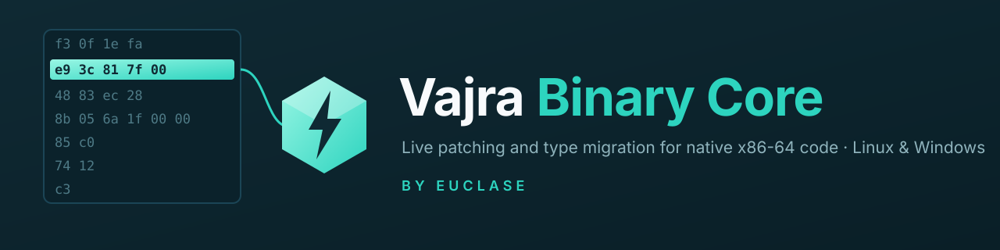

<p align="center"></p>

<p align="center">
  <a href="https://github.com/SemyonZamiakin/VajraBinaryCore/actions/workflows/ci.yml"></a>
  
  
  
  
</p>

<h3 align="center">Change the code <i>and</i> the shape of the data of a running C++ program.<br>No restart. One atomic step. Fully reversible.</h3>

<p align="center">
  <a href="#demo">Demo</a> ·
  <a href="#what-a-patch-looks-like">Example</a> ·
  <a href="docs/DESIGN.md">Design</a> ·
  <a href="#status-what-is-tested-and-what-is-not">What is tested</a> ·
  <a href="#building">Build</a>
</p>

---

Hot-patching a function in a live process is an old trick. The hard part has always been the **data**: the moment the new code expects a struct with a new field, a wider type or a different order, every object already in memory is wrong, and so is every pointer to it. That is usually where live patching ends and the restart begins.

**Vajra does both halves together.** It rewrites machine code while threads keep running, *and* converts every live object of a type to its new layout, fixing up the pointers that refer to them, inside a single transaction that the rest of the program sees as one instantaneous step. If anything fails along the way, nothing has changed. If you change your mind later, it reverts.

| | Inline code hooks | Linux **and** Windows | Stops other threads safely | Migrates live objects to a new struct layout | Code + data in one atomic, revertible transaction |
|---|:---:|:---:|:---:|:---:|:---:|
| **Vajra** | ✅ | ✅ | ✅ | ✅ | ✅ |
| [Microsoft Detours](https://github.com/microsoft/Detours) | ✅ | Windows only | caller lists threads | — | — |
| [MinHook](https://github.com/TsudaKageyu/minhook) | ✅ | Windows only | ✅ | — | — |
| [funchook](https://github.com/kubo/funchook) | ✅ | ✅ | — | — | — |
| Linux kernel livepatch / kpatch | kernel only | Linux kernel | ✅ | adds data via shadow variables, no layout migration | — |

<sub>Comparison based on each project's public documentation at the time of writing; corrections welcome.</sub>

### At a glance

| | |
|---|---|
| **Engine** | ~6 000 lines of C++17, zero dependencies: own x86-64 instruction decoder and relocator, ELF and PE parsers, stop-the-world on two operating systems, migration engine, patch agent |
| **Verified against** | GNU objdump on **2 million+** instructions from real binaries (glibc, libstdc++, ntdll, kernelbase, ...): identical instruction lengths |
| **Tests** | 75 test cases in 11 suites, stress tests that patch while 8 threads hammer the patched code, fault injection at every write, ASan + UBSan, ThreadSanitizer on the cooperative paths |
| **Platforms** | x86-64 Linux (GCC, Clang) · x86-64 Windows (MinGW-w64, MINGW64 and UCRT64) |
| **Safety model** | Refuses what it cannot prove safe: instructions it does not fully understand, branches into the bytes it would overwrite, threads parked inside them, lossy value conversions |

---

## What it is

A live-patching and type-migration engine for native C++ programs on **x86-64 Linux and Windows**. A program that links Vajra can, without restarting:

- **patch machine code**: redirect a function to a new implementation with an inline detour at its entry (the overwritten prologue is relocated into a trampoline, so the original stays callable), or rewrite import slots (ELF GOT/PLT, PE IAT);
- **migrate live data**: convert every live object of a struct from one layout to another (fields added, removed, renamed, reordered, retyped), with conversion rules you choose, and fix up the pointers to those objects;
- do both **in one transaction** that every other thread observes as atomic, and **revert** it later.

It is meant for long-running processes where a restart is expensive: game servers, simulations, trading or telemetry daemons, tools you develop while they run.

## What a patch looks like

```cpp
#include <vajra/vajra.hpp>

// v1 layout, compiled into the running program
struct EntityV1 { std::uint32_t id; std::int32_t hp; float x, y; EntityV1* target; };
// v2 layout, compiled into the patch
struct EntityV2 { EntityV2* target; double health; double x, y; std::uint64_t id; std::int32_t shield; };

const auto v1 = vajra::describe<EntityV1>("Entity", 1, {
    VAJRA_FIELD(EntityV1, id), VAJRA_FIELD(EntityV1, hp), VAJRA_FIELD(EntityV1, x),
    VAJRA_FIELD(EntityV1, y), VAJRA_REF(EntityV1, target, "Entity")});
const auto v2 = vajra::describe<EntityV2>("Entity", 2, {
    VAJRA_REF(EntityV2, target, "Entity"), VAJRA_FIELD(EntityV2, health), VAJRA_FIELD(EntityV2, x),
    VAJRA_FIELD(EntityV2, y), VAJRA_FIELD(EntityV2, id), VAJRA_FIELD(EntityV2, shield)});

vajra::MigrationPlan forward(v1, v2);
forward.rename("hp", "health").fill_int("shield", 50);   // int32 -> double, float -> double: converted
vajra::MigrationPlan inverse(v2, v1);
inverse.rename("health", "hp").drop("shield");

vajra::Patch patch;
vajra::Result r = vajra::Transaction()
    .migrate(heap, forward, inverse)                     // all live Entity objects, pointers fixed up
    .hook(&tick_entity, &tick_entity_v2)                 // code that knows the new layout
    .hook(&spawn_entity, &spawn_entity_v2)
    .commit(&patch);                                     // all or nothing
if (!r) std::fprintf(stderr, "%s\n", r.to_string().c_str());   // nothing was changed
// ... later
patch.revert();                                          // code restored, objects migrated back
```

Patches are usually shipped as a shared library (`.so` / `.dll`) and applied to the running process with `vajractl`, through an agent the program starts (see [Agent and vajractl](#agent-and-vajractl)).

## Demo

`demo/` contains **arena**, a small game-like server: three worker threads tick 128+ entities at 100 Hz, a spawner adds one per second, and a reporter prints the world every second and checks its own invariants (every entity counted once, every `target` pointer valid, the simulation advancing). `demo/run_demo.sh` starts it, applies `libarena_patch_v2` at t=3 s (Entity v1 → v2 plus four replaced functions, including a fixed damage formula), and reverts at t=9 s. Real output (Linux, WSL2):

```
== t=3s: apply v2 patch
ok p1 Entity v1 -> v2, 4 functions replaced
== t=9s: revert
ok
[  2.0s] layout v1  ticks    594  entities 129  total health     7113  deaths   158  #7 hp  28.0 pos ( 35.2, 27.0) shield -  ok
[  3.0s] layout v1  ticks    891  entities 130  total health    11578  deaths   305  #7 hp 100.0 pos ( 23.4, 27.0) shield -  ok
[  4.0s] layout v2  ticks   1188  entities 131  total health    11678  deaths   305  #7 hp 100.0 pos ( 11.5, 27.0) shield 22  ok
[  5.0s] layout v2  ticks   1485  entities 132  total health    11633  deaths   305  #7 hp  95.0 pos (  0.3, 27.0) shield 0  ok
  ...
[ 10.0s] layout v1  ticks   2961  entities 137  total health     6854  deaths   456  #7 hp  64.0 pos ( 59.4, 27.0) shield -  ok
arena: 12 reports, layouts v1 -> v2 -> v1, invariant failures 0, errors 0
```

Entity #7 keeps its identity, health and position through both layout changes; the death rate drops as soon as the fixed damage formula is live; entities spawned after the patch are created in the new layout. The same demo runs on Windows, where the agent listens on a named pipe.

## How it works, briefly

- **Attach model: in-process.** The program links `libvajra` and decides when and how patches arrive (the bundled agent, or its own API calls). There is no external injector; Vajra never attaches to a process that did not opt in.
- **Stopping threads.** Before anything is rewritten, every other thread is stopped and its instruction pointer recorded. Linux: a real-time signal to every thread in `/proc/self/task`, each parking in the handler on a futex. Windows: `NtGetNextThread` + `SuspendThread` + `GetThreadContext`. Enumeration repeats until no new thread appears. If a thread is stopped *inside* the five bytes about to be overwritten, the world is resumed and the stop retried; if it stays there, the patch fails with `Busy` and nothing changes.
- **Safe points for data.** Type migration needs more than stopped threads: a thread could be in the middle of updating a field. Threads that touch migratable objects ("mutators") attach and call `vajra::Safepoints::poll()` at points where they hold no raw pointers into those objects (typically the top of their loop). A migration waits until all of them are parked there.
- **Inline hooks.** The first 5 bytes of the target become `jmp rel32` to a relay near the function; the instructions covering those bytes are re-encoded into a trampoline by an x86-64 instruction decoder (RIP-relative operands fixed, short branches widened, `call` re-encoded; anything unsafe is refused). Bytes after the first five are left untouched, so a thread positioned anywhere past them keeps running original code.
- **W^X.** Code pages are never left writable and executable. Linux writes through `/proc/self/mem` by default (the page protection never changes); otherwise pages are made RW (not X) for the duration of the write while every other thread is stopped. Trampolines are written into fresh RW pages that are switched to RX before they become reachable.
- **Migration.** Objects live in a `vajra::Heap`. All new objects are allocated and filled, and every pointer fix-up planned and validated, *before* anything visible changes; then the swap happens in one step that cannot fail. Pointers are fixed in `Ref` fields of heap objects (also of other types), in registered root slots, and for interior pointers to fields.
- **Rollback.** If any write fails during commit, the writes already made are undone before threads resume, prepared objects are freed, and the `original` pointers handed to the caller are restored.

The full design, including what each guarantee rests on, is in [docs/DESIGN.md](docs/DESIGN.md).

## Platform support

| | Linux x86-64 | Windows x86-64 |
|---|---|---|
| Compilers | GCC, Clang | MinGW-w64 GCC (MSYS2 MINGW64 / UCRT64) |
| Inline hooks + trampolines | yes | yes |
| Import redirection | ELF GOT/PLT (`JUMP_SLOT`, `GLOB_DAT`; lazy and `-z now`) | PE IAT (named imports) |
| Function bounds for safety checks | `.symtab` / `.dynsym` of the module file | `.pdata` unwind table |
| Find functions by name | symbol tables (exported or not, if not stripped) | export tables |
| Stopping threads | real-time signal, futex | `NtGetNextThread` + `SuspendThread` |
| Code writes | `/proc/self/mem`, or `mprotect` RW | `VirtualProtect` RW, or `WriteProcessMemory` |
| Agent transport | Unix socket, mode 0600, `SO_PEERCRED` | named pipe, current-user DACL, local only |
| Sanitizers in the test matrix | ASan + UBSan, TSan (partial, see below) | none |

Not supported: 32-bit x86, arm64, macOS, MSVC (Vajra uses GNU inline assembly), attaching to processes that do not link Vajra, delay-loaded imports on Windows.

## Status: what is tested and what is not

Measured on an i9-9900K: Linux under WSL2 (Ubuntu, kernel 6.18, GCC 15.2, Clang 21.1), Windows 11 natively (MSYS2 MinGW-w64 GCC 15, MINGW64 and UCRT64).

| Suite | What it covers |
|---|---|
| `test_decoder` | Lengths and properties of hand-assembled instructions: prefixes, REX, VEX, EVEX, 0F/0F38/0F3A, ModRM/SIB/displacements, immediates, RIP-relative operands, relative branches, invalid and deliberately unsupported encodings (XOP, APX), truncation, the 15-byte limit |
| `decoder_vs_objdump` | Every instruction GNU objdump decodes in real binaries gets the same length from Vajra. Linux: libc, libstdc++, Vajra and a test binary (~1 M instructions per run; locally also libm, bash and libcrypto, 2.0 M in total). Windows: ntdll, kernelbase, libstdc++, Vajra (~1.4 M). The only differences are objdump fusing `fwait` with the next x87 instruction and AMD XOP / Intel APX encodings, which Vajra refuses on purpose |
| `test_relocate` | Byte-exact relocation: RIP-relative fix-ups, `jcc` rel8 → rel32 and the far form, `call` near and far, chained hooks, every refusal rule |
| `test_hook` | Real hooks on compiled C++ functions and hand-written assembly prologues (RIP-relative load, `jcc` in the prologue, `call` in the prologue, a 3-byte function with padding), a C runtime function in another module, chaining and revert order, hook by name, all write methods, refusals |
| `test_transaction` | Fault injection at every write position (all earlier writes rolled back, original pointers restored), a failing revert leaves the patch fully applied, `Busy` when a thread sits inside the patched bytes, code + migration in one transaction, a failing migration leaves code untouched |
| `test_stop` | The world stop freezes every thread (counters do not move), threads created during the stop are caught, a thread's recorded PC is exact; Linux: a thread blocking the signal makes the stop time out and everyone resumes; cooperative stop, blocking regions, late attach |
| `test_migrate` | Descriptor validation, plan compilation errors, strict and saturating conversions between every numeric kind (including edge values like 2^53+1, −0.0, NaN, ±∞), byte fields, typed object views, end-to-end migration with refs, roots, interior pointers and cross-type references, failure atomicity on 200 objects, dangling-reference detection, quarantine mode, inverse migration |
| `test_got_*` / `test_iat` | Import redirection before and after the first call, stacking and revert order, filters, fault injection, 300 redirect/revert cycles while 4 threads call through the slot. Linux builds it three ways: lazy binding, full RELRO, `-fno-plt` |
| `test_stress` | 750 hook/revert cycles (two patcher threads) while 8 threads call the patched functions and check every result; 60 cycles of "migrate + hook, revert" while 4 mutator threads keep transferring money between accounts (the total must be preserved); 60 append-only migrations under load |
| `test_agent` | The agent over its real transport through `vajractl`: ping, apply, list, revert, module checks (missing file, unsafe permissions on Linux, not a module), pipe-name squatting on Windows |
| `demo_live_patch` | The arena demo above, end to end |

Configurations run locally for this release, all passing: Linux GCC `-Werror` RelWithDebInfo, Clang `-Werror` Release, GCC Debug (`-O0`, different prologues), Clang ASan + UBSan; Windows MinGW64 GCC RelWithDebInfo and Debug, UCRT64 GCC. `scripts/check.sh` runs the Linux matrix. GitHub Actions repeats this on every push: Linux GCC (RelWithDebInfo, Debug), Clang (Release, ASan + UBSan, TSan), Windows MINGW64 and UCRT64, and an install-and-consume check of the CMake package.

**ThreadSanitizer** runs only the parts that do not stop threads by signal (decoder, relocation, migration with cooperative safe points, cooperative stop tests, the append-only migration storm): TSan defers asynchronous signals until a thread enters its runtime, so the signal-based world stop that every code patch needs cannot work under it. The code-patching paths are covered by ASan/UBSan and the stress tests instead.

**Not tested / known limits:**

- No external review or fuzzing of the decoder beyond the objdump comparison; encodings that do not occur in the scanned binaries are covered only by the hand-written table.
- Hooks rely on function bounds to check that no branch inside the function targets the overwritten bytes. Branches from *other* functions (e.g. GCC's `foo.cold` parts jumping back into `foo`) and computed jumps through jump tables are not checked. Functions without bounds (stripped Linux binaries, Windows leaf functions without `.pdata`) are refused unless `allow_unknown_bounds` is set.
- A thread that blocks the stop signal (Linux) makes every code patch time out. Threads blocked in system calls are interrupted (`EINTR` where a call is not restarted).
- Pointers to migrated objects that live outside the heap and outside registered roots are **not** updated. Quarantine mode (`Heap::set_quarantine`) helps find them.
- Trampoline pages are never freed, even after revert (a thread may still be executing one). Each committed transaction costs one 4 KiB page (64 KiB on Windows) per hooked code region.
- Patch modules are never unloaded.
- Not measured: patch latency under large thread counts, memory overhead in long sessions with thousands of patches.

## Agent and vajractl

```cpp
vajra::Agent agent;
vajra::Agent::Options o;
o.socket_path = "/run/user/1000/myserver/vajra.sock";   // Windows: R"(\\.\pipe\myserver-vajra)"
o.heap = &heap;                                          // handed to patch modules
agent.start(o);
```

```bash
vajractl /run/user/1000/myserver/vajra.sock ping
vajractl /run/user/1000/myserver/vajra.sock apply ./libmy_patch_v2.so    # -> ok p1
vajractl /run/user/1000/myserver/vajra.sock list
vajractl /run/user/1000/myserver/vajra.sock revert p1
```

A patch module exports one function:

```cpp
VAJRA_PATCH_ENTRY {                                       // extern "C" int vajra_patch_entry(vajra::PatchContext*)
    void* old_fn = vajra::find_function("tick_entity");  // host functions by name (.so and .dll alike)
    ctx->tx->hook(old_fn, reinterpret_cast<void*>(&tick_entity_v2))
             .migrate(*ctx->heap, forward, inverse);
    return 0;                                             // non-zero: nothing is applied
}
```

Mark functions you plan to patch with `VAJRA_PATCHABLE` (no inlining, no IPA cloning, visible by name). See [SECURITY.md](SECURITY.md) for what the agent does and does not protect against.

## Building

Requirements: CMake 3.16+, GCC or Clang with C++17. Linux: tested with GCC 15 and Clang 21. Windows: MinGW-w64 GCC from [MSYS2](https://www.msys2.org) (MINGW64 or UCRT64); MSVC is not supported.

```bash
cmake -S . -B build -DCMAKE_BUILD_TYPE=Release
cmake --build build -j
ctest --test-dir build --output-on-failure
sudo cmake --install build      # optional: headers, libvajra, vajractl, CMake package
```

On Windows, from an MSYS2 MINGW64 shell (or with `C:\msys64\mingw64\bin` on `PATH`), add `-G "MinGW Makefiles"` (or `-G Ninja`) to the first command. The demo test needs `bash` (MSYS2 or Git for Windows).

In your project: `find_package(Vajra REQUIRED)` and `target_link_libraries(app PRIVATE Vajra::vajra)`, or `add_subdirectory` this repository.

Useful build options: `VAJRA_WERROR`, `VAJRA_BUILD_TESTS`, `VAJRA_BUILD_DEMO`, `VAJRA_SANITIZE=address,undefined|thread` (Linux).

## License

MIT, see [LICENSE](LICENSE). Copyright (c) 2026 Euclase.
